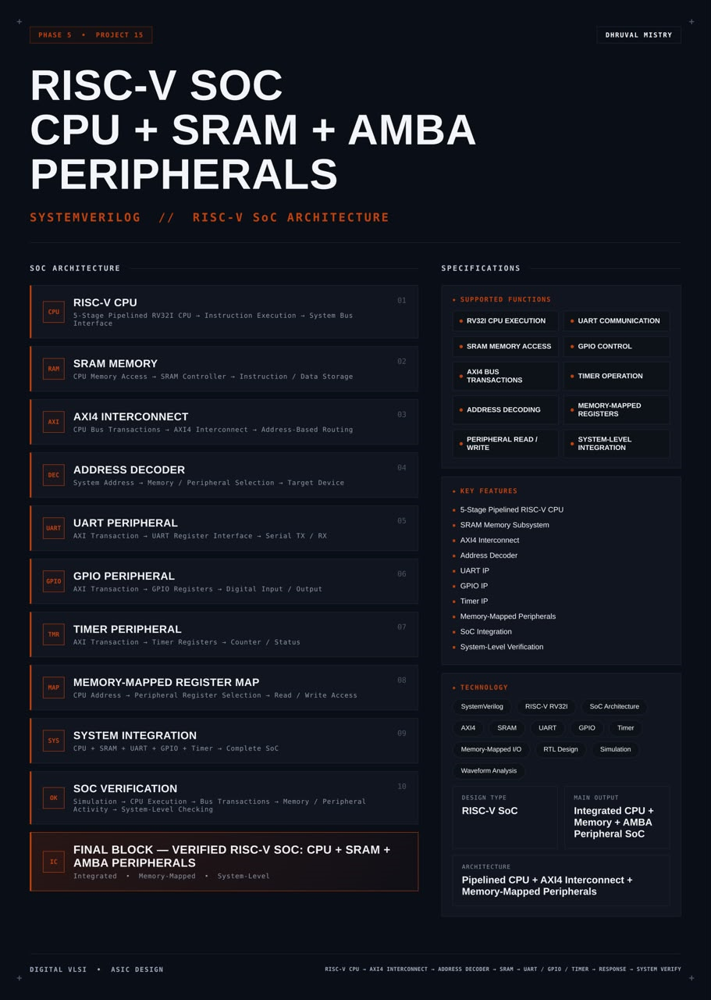
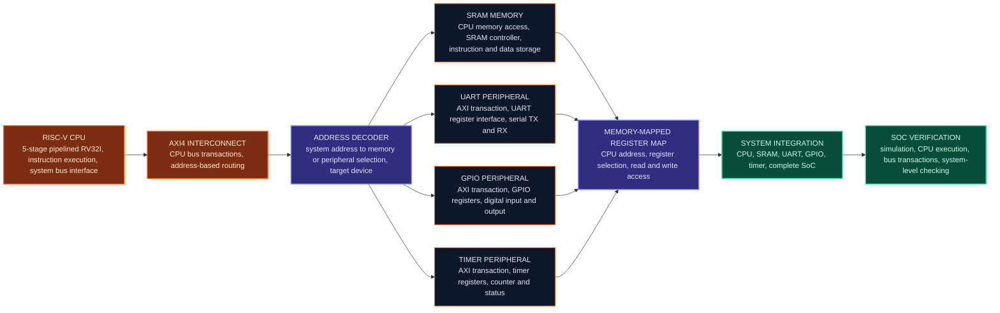
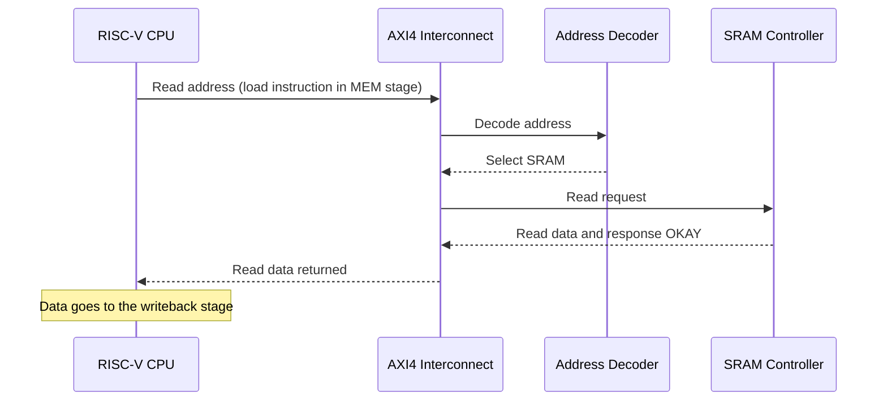
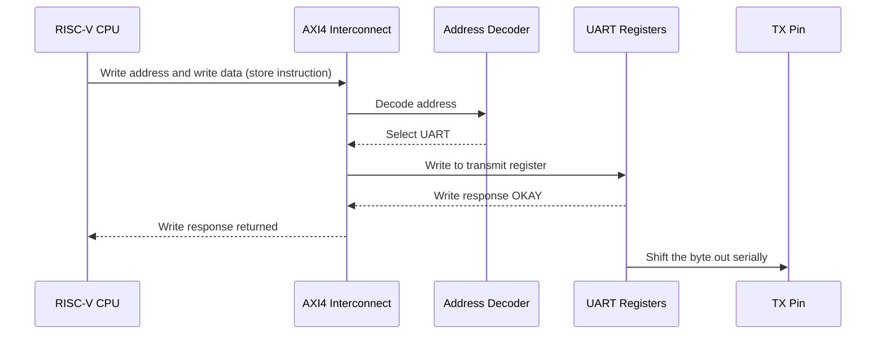
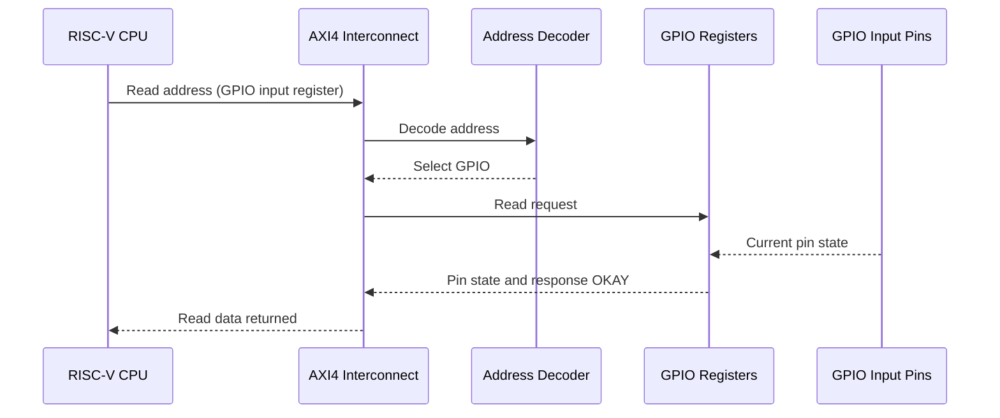
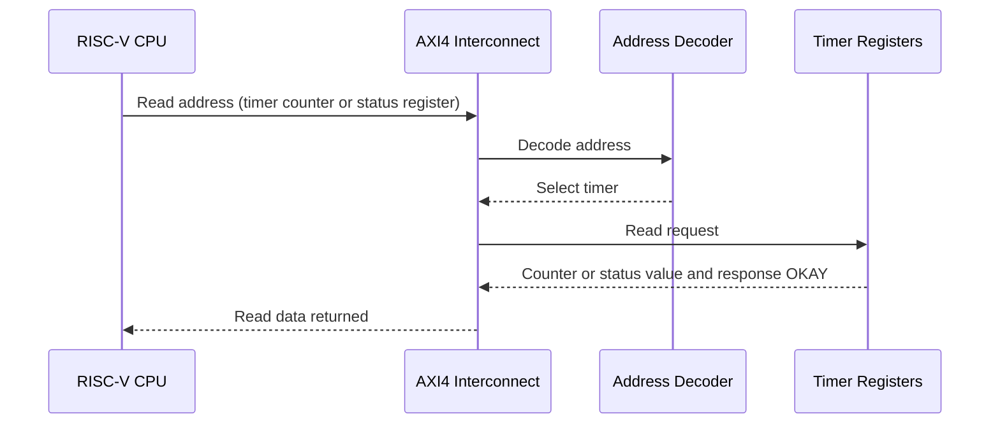
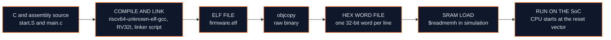
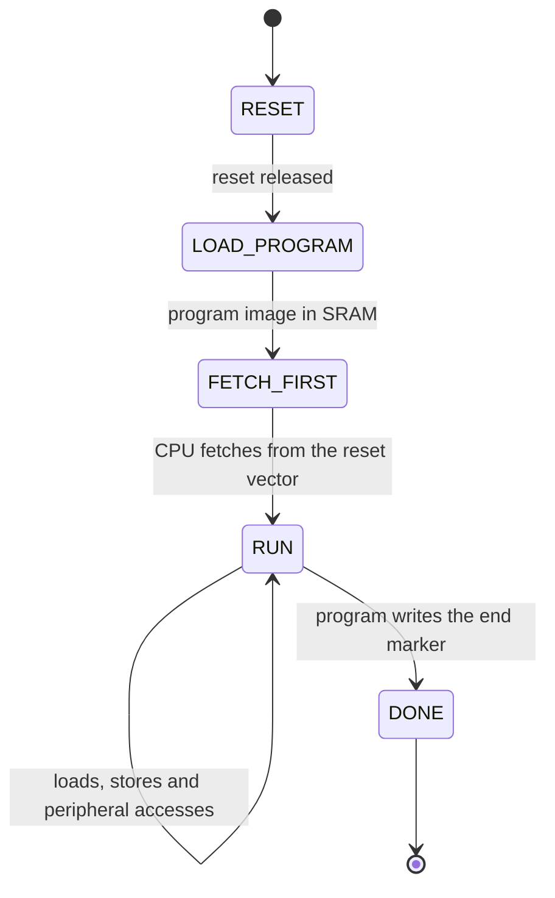
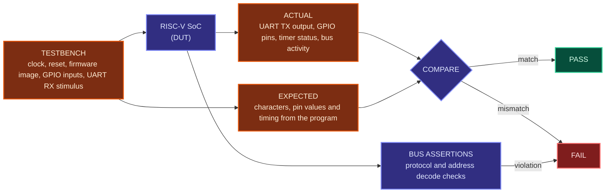

<div align="center">




<b>A synthesizable RISC-V system-on-chip that integrates a 5-stage pipelined RV32I CPU, SRAM, an AXI4 interconnect with address decoding, and UART, GPIO and timer peripherals behind a memory-mapped register map, written in SystemVerilog.</b>

<br/>


<br/>

[Overview](#overview) |
[At a Glance](#project-at-a-glance) |
[Background](#background-from-processor-to-soc) |
[Functions](#supported-functions) |
[Architecture](#architecture) |
[Functional Description](#functional-description) |
[Memory Map](#memory-map-and-address-decoding) |
[Bus Transactions](#bus-transactions) |
[Software View](#software-view) |
[Interface](#interface) |
[Boot and Operation](#boot-and-operating-sequence) |
[Getting Started](#getting-started) |
[Verification](#verification) |
[Synthesis](#synthesis) |
[Applications](#applications) |
[FAQ](#faq) |
[License](#license)

</div>

---

## Overview

This project implements a **RISC-V system-on-chip (SoC)** in **SystemVerilog**. It takes a processor core and builds around it everything that is needed to run a real program: memory to hold the code and data, a bus to connect the pieces, an address decoder to steer every access to the right place, and a set of peripherals that let the program talk to the outside world.

The **CPU** is a **5-stage pipelined RV32I** core. It executes instructions and reaches memory and peripherals through a **system bus interface**. The **SRAM** with its **SRAM controller** stores both instructions and data. An **AXI4 interconnect** carries the CPU's **bus transactions** and performs **address-based routing**, helped by an **address decoder** that turns a system address into the selection of a memory or peripheral target. Three peripherals are attached: a **UART** that turns register writes into serial transmit data and serial receive data into register reads, a **GPIO** block with digital input and output registers, and a **timer** with a counter and status registers. All of them are controlled as **memory-mapped registers**: software reads and writes ordinary addresses, and the SoC turns these accesses into hardware actions.

The result is a **complete, integrated SoC**: CPU, SRAM, UART, GPIO and timer. It is verified at the **system level**: a program runs on the CPU, the simulation observes the bus transactions and the memory and peripheral activity, and the testbench checks the results at the pins of the chip. The design is **parameterized**, written in a **synthesis-friendly** style, simulated at RTL level, inspected through waveform analysis and packaged as a reusable SoC reference design.

<table>
<tr>
<td width="50%" valign="top">

#### Objectives
- Integrate a pipelined RV32I CPU, SRAM and peripherals into one SoC
- Connect the CPU to memory and peripherals through an AXI4 interconnect
- Decode system addresses to select the right memory or peripheral
- Provide UART, GPIO and timer peripherals as memory-mapped registers
- Define a clear memory map that software can rely on
- Run a program compiled with the RISC-V GNU toolchain on the SoC
- Verify the whole system: CPU execution, bus transactions, memory and peripheral activity

</td>
<td width="50%" valign="top">

#### Key Features
- 5-stage pipelined RV32I CPU
- SRAM memory subsystem
- AXI4 interconnect
- Address decoder
- UART IP
- GPIO IP
- Timer IP
- Memory-mapped peripherals
- SoC integration
- System-level verification

</td>
</tr>
</table>

---

## Project at a Glance

| Attribute | Detail |
|:--|:--|
| **Design type** | RISC-V SoC |
| **Description language** | SystemVerilog (RTL) |
| **Processor** | 5-stage pipelined RV32I CPU |
| **Memory** | SRAM with an SRAM controller, holding instructions and data |
| **Bus** | AXI4 interconnect with address-based routing |
| **Address decoding** | System address to memory or peripheral selection |
| **Peripherals** | UART, GPIO, timer |
| **Control method** | Memory-mapped registers, read and write access |
| **Clocking** | Single clock domain for the whole SoC |
| **Main output** | Integrated CPU, memory and AMBA peripheral SoC |
| **Architecture** | Pipelined CPU, AXI4 interconnect and memory-mapped peripherals |
| **Software flow** | RISC-V GNU toolchain, program loaded into SRAM |
| **Verification** | System-level simulation, bus checks, waveform analysis |
| **Functions** | 10 (CPU execution, memory, bus, decoding, peripherals, registers, integration) |
| **Simulation** | Verilator |
| **Waveform analysis** | GTKWave |
| **Synthesis** | Yosys |
| **License** | MIT |

---

## Background: From Processor to SoC

A processor on its own cannot do anything useful. It needs instructions to execute, memory for its data and some way to send and receive information. A **system-on-chip** puts all of this on one piece of silicon, so that the processor, the memory and the peripherals work together as one system.

Three ideas make that possible.

**A shared bus.** The processor does not have a dedicated wire to every device. It issues **bus transactions**, which are reads and writes with an address, over a shared interconnect. The interconnect carries each transaction to the device that owns the address and returns the response. Using a standard bus such as **AMBA AXI4** means devices can be added or replaced without changing the processor.

**An address map.** Every device owns a range of addresses. The SRAM owns one range, the UART another, and so on. The **address decoder** compares the address of each transaction with these ranges and picks the target. Together the ranges form the **memory map** of the SoC.

**Memory-mapped I/O.** Peripherals are controlled through **registers** that sit at addresses in the memory map. To send a character, software writes the character to a UART register. To read a switch, it reads a GPIO register. To wait for a time, it reads a timer register. The processor needs no special input and output instructions: ordinary load and store instructions are enough.

Building an SoC covers the skills that a modern chip design needs: processor integration, bus protocols, address decoding, peripheral design, memory interfacing, and system-level verification where software and hardware are checked together.

---

## Supported Functions

| Group | Function | Description |
|:--|:--|:--|
| **CPU** | `RV32I CPU EXECUTION` | Executes RV32I instructions on a 5-stage pipeline |
| **Memory** | `SRAM MEMORY ACCESS` | Reads and writes instructions and data in SRAM |
| **Bus** | `AXI4 BUS TRANSACTIONS` | Carries CPU reads and writes over the AXI4 interconnect |
| **Bus** | `ADDRESS DECODING` | Selects the memory or peripheral that owns an address |
| **Peripherals** | `PERIPHERAL READ / WRITE` | Reads and writes peripheral registers through the bus |
| **Peripherals** | `UART COMMUNICATION` | Serial transmit and receive through UART registers |
| **Peripherals** | `GPIO CONTROL` | Digital input and output through GPIO registers |
| **Peripherals** | `TIMER OPERATION` | Counting and status reporting through timer registers |
| **Control** | `MEMORY-MAPPED REGISTERS` | Peripheral control and status at fixed addresses |
| **Integration** | `SYSTEM-LEVEL INTEGRATION` | CPU, SRAM, UART, GPIO and timer working as one SoC |

---

## Architecture

The SoC is organized around the interconnect. The CPU is the bus master. The AXI4 interconnect, with the address decoder inside it, routes every CPU transaction to one target: the SRAM through its controller, or one of the three peripherals through its register interface.

#### Block diagram

```text
                           +-----------------------------------------------------------+
                           |                         RISC-V SoC                        |
                           |                                                           |
                           |   +-----------------------------------------+             |
                           |   |        RISC-V CPU (5-stage RV32I)       |             |
                           |   |  IF -> ID -> EX -> MEM -> WB            |             |
                           |   |  system bus interface                   |             |
                           |   +--------------------+--------------------+             |
                           |                        | CPU bus transactions             |
                           |                        v                                  |
                           |   +-----------------------------------------+             |
                           |   |           AXI4 INTERCONNECT             |             |
                           |   |   address-based routing                 |             |
                           |   |   +---------------------------------+   |             |
                           |   |   |        ADDRESS DECODER          |   |             |
                           |   |   |  system address -> target       |   |             |
                           |   |   +---------------------------------+   |             |
                           |   +----+--------+----------+---------+------+             |
                           |        |        |          |         |                    |
                           |        v        v          v         v                    |
                           |   +--------+ +--------+ +--------+ +--------+             |
                           |   |  SRAM  | |  UART  | |  GPIO  | | TIMER  |             |
                           |   | CTRL + | | regs   | | regs   | | regs   |             |
                           |   | ARRAY  | |        | |        | |        |             |
                           |   +--------+ +---+----+ +---+----+ +---+----+             |
                           |                  |          |          |                  |
                           +------------------|----------|----------|------------------+
                                              v          v          v
                                        UART TX / RX   GPIO PINS   TIMER STATUS
                                                                   (interrupt, if provided)

                  CLK, RESET go to every block
```

#### Data flow



#### Block breakdown

| # | Block | Role |
|:-:|:--|:--|
| `01` | **RISC-V CPU** | 5-stage pipelined RV32I CPU. Executes instructions and reaches the bus through the system bus interface |
| `02` | **SRAM Memory** | CPU memory access through an SRAM controller. Stores instructions and data |
| `03` | **AXI4 Interconnect** | Carries CPU bus transactions and routes them by address |
| `04` | **Address Decoder** | Turns a system address into a memory or peripheral selection, the target device |
| `05` | **UART Peripheral** | AXI transaction to UART register interface to serial TX and RX |
| `06` | **GPIO Peripheral** | AXI transaction to GPIO registers to digital input and output |
| `07` | **Timer Peripheral** | AXI transaction to timer registers, with a counter and status |
| `08` | **Memory-Mapped Register Map** | CPU address to peripheral register selection to read and write access |
| `09` | **System Integration** | CPU, SRAM, UART, GPIO and timer connected as a complete SoC |
| `10` | **SoC Verification** | Simulation, CPU execution, bus transactions, memory and peripheral activity, system-level checking |

> **Final design block:** `RISC-V CPU -> AXI4 INTERCONNECT -> ADDRESS DECODER -> SRAM -> UART / GPIO / TIMER -> RESPONSE -> SYSTEM VERIFY`

---

## Functional Description

Each block is described here only as far as the integration needs. The internal design of the CPU, the interconnect and each peripheral is a topic of its own, and this section covers what each one looks like from the rest of the SoC.

#### RISC-V CPU
A 5-stage pipelined RV32I processor with the stages instruction fetch, decode, execute, memory access and writeback. It fetches instructions, executes them, and performs loads and stores. Everything outside the pipeline is reached through the **system bus interface**, which turns instruction fetches, loads and stores into bus transactions and waits for the response. From the SoC point of view the CPU is the bus master. Whether instruction fetches and data accesses share one bus port or use separate ports is listed in the configuration table.

#### SRAM memory
The memory that holds the program and its data. An **SRAM controller** connects the memory array to the bus: it accepts read and write transactions, turns them into array accesses and returns the data and the response. Because instructions and data both live in the SRAM, the program image must be loaded into it before the CPU starts. How the image is loaded is listed in the [boot flow](#boot-and-operating-sequence).

#### AXI4 interconnect
Connects the CPU to all the targets. It receives the CPU's bus transactions, uses the address decoder to find the target and forwards the transaction there. It then returns the response of that target to the CPU. Only one target is involved in a transaction, and transactions on different targets follow one after another according to the rules of the interconnect.

#### Address decoder
Compares the address of every transaction with the address range of each target and produces the selection of exactly one target. An address that belongs to no target is an invalid address, and the SoC answers it with an error response instead of leaving the CPU waiting. See [Memory Map and Address Decoding](#memory-map-and-address-decoding).

#### UART peripheral
Provides serial communication. Software writes a byte to a **transmit register** and the UART sends it out serially on the TX pin. Bytes that arrive on the RX pin are collected and can be read from a **receive register**. A **status register** reports whether the transmitter is busy and whether received data is available. The UART is controlled only through its registers.

#### GPIO peripheral
Provides general-purpose digital pins. A **direction register** sets each pin as input or output, an **output register** drives the output pins, and an **input register** returns the state of the input pins.

#### Timer peripheral
Provides time measurement. A **counter** counts clock cycles (optionally through a prescaler), a **control register** starts and stops it, and a **status register** reports events such as the counter reaching its limit. Software can read the counter to measure time, or poll the status to wait for a delay.

#### Memory-mapped register map
The set of registers of all peripherals, placed at fixed addresses. It is the contract between hardware and software: the register addresses and meanings stay the same, so a program written against the map works on every build of the SoC.

#### System integration
Connects the CPU, the interconnect, the SRAM and the peripherals with one clock and one reset, and brings the pins of the UART and GPIO out of the chip. Integration is where the blocks meet, so it is also where mistakes in address maps, widths, resets and bus handshakes show up.

---

## Memory Map and Address Decoding

#### SoC memory map

Each target owns a range given by a base address and a size.

| Target | Base address | Size | Address range |
|:--|:-:|:-:|:--|
| SRAM (instructions and data) | `TBD` | `TBD` | `TBD` |
| UART registers | `TBD` | `TBD` | `TBD` |
| GPIO registers | `TBD` | `TBD` | `TBD` |
| Timer registers | `TBD` | `TBD` | `TBD` |
| Reset vector (first instruction address) | `TBD` | not applicable | `TBD` |

The base addresses and sizes are set in the RTL sources under `rtl/` and are the single reference for the software.

#### Illustrative memory map

The values below only show how a map can look. They are not the map of this SoC.

| Target | Base address | Size | Address range |
|:--|:-:|:-:|:--|
| SRAM | `0x0000_0000` | 64 KB | `0x0000_0000` to `0x0000_FFFF` |
| UART | `0x4000_0000` | 4 KB | `0x4000_0000` to `0x4000_0FFF` |
| GPIO | `0x4000_1000` | 4 KB | `0x4000_1000` to `0x4000_1FFF` |
| Timer | `0x4000_2000` | 4 KB | `0x4000_2000` to `0x4000_2FFF` |
| Anything else | not applicable | not applicable | Error response |

#### Decoding rule

For each target, the decoder asks whether the address lies inside its range:

```text
select[i]  =  ( address >= BASE[i] )  AND  ( address < BASE[i] + SIZE[i] )
```

When every range is a power-of-two size that starts on a multiple of its size, only the upper address bits need to be compared. The low bits then select a register or a word inside the target.

| Matches found | Meaning | Action |
|:-:|:--|:--|
| Exactly one | Address belongs to one target | Route the transaction to that target |
| None | Address belongs to no target | Answer with an error response |
| More than one | Ranges overlap | Not allowed. The map must not overlap |

#### Register map of the peripherals

The registers are word addressed inside each peripheral. The exact offsets, bit positions and reset values are defined in the RTL sources.

| Peripheral | Register | Access | Offset | Description |
|:--|:--|:-:|:-:|:--|
| UART | Transmit data | Write | `TBD` | Byte to be sent on TX |
| UART | Receive data | Read | `TBD` | Byte received on RX |
| UART | Status | Read | `TBD` | Transmitter busy, receive data available, error flags |
| UART | Control | Read / write | `TBD` | Enable and configuration |
| GPIO | Direction | Read / write | `TBD` | Per pin: input or output |
| GPIO | Output data | Read / write | `TBD` | Value driven on the output pins |
| GPIO | Input data | Read | `TBD` | Current state of the input pins |
| Timer | Control | Read / write | `TBD` | Enable, start and stop |
| Timer | Counter | Read | `TBD` | Current counter value |
| Timer | Reload / compare | Read / write | `TBD` | Limit for the counter, if provided |
| Timer | Status | Read | `TBD` | Event flags, such as the counter reaching its limit |

#### Access rules

| Access | Expected behavior |
|:--|:--|
| Load or store to SRAM | Data is read or written, and the response is OKAY |
| Read of a peripheral register | Register value is returned, and the response is OKAY |
| Write to a read/write peripheral register | Register is updated, and the response is OKAY |
| Write to a read-only register | Register does not change, and the response follows the defined error rule |
| Access to an unmapped address | No target is affected, and the response follows the defined error rule |

---

## Bus Transactions

Every memory and peripheral access is a bus transaction that travels from the CPU through the interconnect and the decoder to one target and back. The diagrams below show four typical accesses.

#### Load from SRAM



#### Store to a UART register (send a character)



#### GPIO read



#### Timer read



#### What the CPU waits for

| Situation | Effect on the pipeline |
|:--|:--|
| Response comes in the same cycle | No stall |
| Response takes several cycles | The pipeline stalls until the response arrives |
| Error response | Defined by the CPU, listed in the configuration table |

The number of cycles per access depends on the interconnect, the SRAM controller and the peripherals, and is listed in the configuration table.

---

## Software View

From the software side the SoC is a memory with some special addresses. The program is compiled with the **RISC-V GNU toolchain** for the RV32I base instruction set, loaded into the SRAM, and started from the reset vector.

#### Example program (illustrative)

The register names and the base addresses below are illustrative and follow the illustrative memory map above. The real names and addresses are in the register map of the RTL sources.

```c
#define UART_TXDATA   (*(volatile unsigned int *)0x40000000)
#define UART_STATUS   (*(volatile unsigned int *)0x40000004)
#define GPIO_DIR      (*(volatile unsigned int *)0x40001000)
#define GPIO_OUT      (*(volatile unsigned int *)0x40001004)
#define TIMER_COUNT   (*(volatile unsigned int *)0x40002004)

#define UART_TX_BUSY  (1u << 0)

static void uart_putc(char c) {
    while (UART_STATUS & UART_TX_BUSY) { }   // wait until the transmitter is free
    UART_TXDATA = (unsigned int)c;           // store to the UART transmit register
}

static void wait_ticks(unsigned int ticks) {
    unsigned int start = TIMER_COUNT;        // read the timer counter
    while ((TIMER_COUNT - start) < ticks) { }
}

int main(void) {
    GPIO_DIR = 0x1;                          // pin 0 as output
    uart_putc('H');                          // print a character over UART
    GPIO_OUT = 0x1;                          // pin 0 high
    wait_ticks(1000);                        // wait on the timer
    GPIO_OUT = 0x0;                          // pin 0 low
    for (;;) { }                             // end of program
}
```

Every access to a register is a load or a store, so each line that touches `UART_`, `GPIO_` or `TIMER_` becomes a bus transaction through the interconnect.

#### Build flow



```bash
# Compile and link for RV32I, with no standard library, using a linker script that places code at the SRAM base
riscv64-unknown-elf-gcc -march=rv32i -mabi=ilp32 -nostdlib -nostartfiles \
  -T sw/link.ld -o sw/firmware.elf sw/start.S sw/main.c

# Raw binary, then one hex word per line for $readmemh
riscv64-unknown-elf-objcopy -O binary sw/firmware.elf sw/firmware.bin
od -An -v -tx4 -w4 sw/firmware.bin > sw/firmware.hex
```

#### Start-up code

The start-up file `start.S` runs first. It sets the stack pointer to the top of the SRAM, may clear the uninitialized data area, and then jumps to `main`. Because the SoC has no operating system, the start-up code and the linker script are the only things between reset and `main`.

#### Linker script (outline)

```text
MEMORY  { SRAM (rwx) : ORIGIN = <SRAM base>, LENGTH = <SRAM size> }
SECTIONS
{
    .text : { *(.text.start) *(.text*) } > SRAM
    .rodata : { *(.rodata*) } > SRAM
    .data : { *(.data*) } > SRAM
    .bss : { *(.bss*) *(COMMON) } > SRAM
}
```

The origin and the length come from the memory map table. Using the same numbers in the RTL and in the linker script is the most important consistency rule of the SoC.

---

## Interface

#### Ports of the SoC top level

| Port | Direction | Description |
|:--|:-:|:--|
| Clock | Input | Clock for the whole SoC |
| Reset | Input | Reset for the whole SoC |
| UART TX | Output | UART serial transmit pin |
| UART RX | Input | UART serial receive pin |
| GPIO input | Input | Digital input pins |
| GPIO output | Output | Digital output pins |
| GPIO direction | Output | Pin direction, if the pins are bidirectional |
| Timer event | Output | Timer status event or interrupt request, if provided |

Exact port names, widths and reset polarity are defined in the RTL sources under `rtl/`.

#### Internal bus connections

| Connection | Description |
|:--|:--|
| CPU to interconnect | Bus master port or ports of the CPU |
| Interconnect to SRAM | Slave port with the SRAM controller |
| Interconnect to UART | Slave port with the UART register interface |
| Interconnect to GPIO | Slave port with the GPIO register interface |
| Interconnect to timer | Slave port with the timer register interface |

#### Parameters and configuration

| Item | Value |
|:--|:-:|
| System clock frequency | `TBD` |
| Reset polarity | `TBD` |
| Reset vector address | `TBD` |
| SRAM size | `TBD` |
| Bus master structure (single port or separate instruction and data ports) | `TBD` |
| Bus variant on the peripheral ports (AXI4 or AXI4-Lite) | `TBD` |
| Address and data width | `TBD` |
| Response to an unmapped address | `TBD` |
| CPU action on an error response | `TBD` |
| Wait cycles of SRAM and peripherals | `TBD` |
| UART baud rate and frame format | `TBD` |
| Number of GPIO pins | `TBD` |
| Timer counter width and prescaler | `TBD` |
| Program loading method | `TBD` |

---

## Boot and Operating Sequence

After reset, the CPU starts executing at the **reset vector**. The program must already be present in the SRAM at that point. In simulation, the SRAM is filled from the hex file with `$readmemh` before the clock starts, and how the image is loaded in other setups is listed in the configuration table.



| State | Behavior |
|:--|:--|
| `RESET` | All blocks are in their reset state, the CPU holds its program counter at the reset vector |
| `LOAD_PROGRAM` | The program image is placed in the SRAM before execution starts |
| `FETCH_FIRST` | The first instruction is fetched through the bus from the SRAM |
| `RUN` | The CPU executes the program, and every memory and peripheral access is a bus transaction |
| `DONE` | The end-of-test marker defined by the testbench has been produced |

#### Operating sequence

1. **Reset.** The reset brings the CPU, the interconnect, the SRAM controller and the peripherals to their initial state.
2. **Load.** The program image is available in the SRAM.
3. **Boot.** The CPU fetches its first instruction from the reset vector through the interconnect.
4. **Set up.** The program sets the GPIO direction and, if needed, the UART and timer configuration.
5. **Run.** The program reads and writes data in the SRAM, sends characters through the UART, drives GPIO pins and measures time with the timer.
6. **Observe.** The outside world sees the UART serial line and the GPIO pins. The testbench also watches the bus and the memory.
7. **Finish.** The program signals the end of the test in the way defined by the testbench.

---

## Repository Structure

```text
risc-v-soc-cpu-sram-amba-peripherals/
├── rtl/
│   ├── cpu/                    # 5-stage pipelined RV32I CPU and its bus interface
│   ├── axi4_interconnect.sv    # AXI4 interconnect with address-based routing
│   ├── addr_decoder.sv         # System address decoder
│   ├── sram_ctrl.sv            # SRAM controller
│   ├── sram_array.sv           # SRAM memory array
│   ├── uart_periph.sv          # UART with register interface
│   ├── gpio_periph.sv          # GPIO with register interface
│   ├── timer_periph.sv         # Timer with register interface
│   └── soc_top.sv              # Top-level SoC
├── sw/
│   ├── start.S                 # Start-up code
│   ├── main.c                  # Example program
│   ├── link.ld                 # Linker script
│   └── firmware.hex            # Program image loaded into the SRAM
├── tb/
│   ├── uart_monitor.sv         # Decodes the UART TX line
│   ├── bus_checker.sv          # Bus protocol and address decode assertions
│   └── soc_tb.sv               # System-level testbench
├── sim/
│   └── waves.vcd               # Generated waveform dump
├── synth/
│   ├── synth.ys                # Yosys synthesis script
│   ├── soc_netlist.v           # Gate-level netlist
│   └── synth_report.txt        # Yosys stat report
├── LICENSE
└── README.md
```

---

## Technology Stack

| Tool | Role in this project |
|:--|:--|
|  | RTL design, testbench and assertions |
|  | Compiles the programs that run on the SoC |
|  | Compiles and simulates the SoC |
|  | Views the simulation waveforms |
|  | Synthesizes the RTL to a gate-level netlist |

---

## Getting Started

#### Prerequisites

| Tool | Purpose | Version |
|:--|:--|:--|
| Verilator | RTL simulation | 5.x or later |
| GTKWave | Waveform viewer | Any recent |
| Yosys | RTL synthesis | Any recent |
| RISC-V GNU toolchain | Compile programs for the SoC | Any recent, with RV32I support |

```bash
# Ubuntu / Debian
sudo apt update
sudo apt install verilator gtkwave yosys gcc-riscv64-unknown-elf
```

If the package name differs on the system, any RISC-V GNU toolchain that can target `rv32i` works. The tool prefix may also differ, for example `riscv32-unknown-elf-`.

#### 1. Clone

```bash
git clone https://github.com/dhruvalmistry2007/risc-v-soc-cpu-sram-amba-peripherals.git
cd risc-v-soc-cpu-sram-amba-peripherals
```

#### 2. Build the program

```bash
riscv64-unknown-elf-gcc -march=rv32i -mabi=ilp32 -nostdlib -nostartfiles \
  -T sw/link.ld -o sw/firmware.elf sw/start.S sw/main.c
riscv64-unknown-elf-objcopy -O binary sw/firmware.elf sw/firmware.bin
od -An -v -tx4 -w4 sw/firmware.bin > sw/firmware.hex
```

#### 3. Simulate the SoC

The testbench uses clock and delay statements and a UART monitor, so the simulation is built with timing support.

```bash
verilator --binary --timing --trace --assert -Wall --top-module soc_tb \
  rtl/cpu/*.sv rtl/sram_array.sv rtl/sram_ctrl.sv rtl/addr_decoder.sv rtl/axi4_interconnect.sv \
  rtl/uart_periph.sv rtl/gpio_periph.sv rtl/timer_periph.sv rtl/soc_top.sv \
  tb/uart_monitor.sv tb/bus_checker.sv tb/soc_tb.sv
./obj_dir/Vsoc_tb +firmware=sw/firmware.hex
```

#### 4. View waveforms

```bash
gtkwave sim/waves.vcd
```

#### 5. Synthesize

```bash
yosys -p "read_verilog -sv rtl/cpu/*.sv rtl/sram_array.sv rtl/sram_ctrl.sv rtl/addr_decoder.sv rtl/axi4_interconnect.sv rtl/uart_periph.sv rtl/gpio_periph.sv rtl/timer_periph.sv rtl/soc_top.sv; synth -top soc_top; stat; write_verilog synth/soc_netlist.v"
```

---

## Verification

Verification is done at the **system level**: instead of testing each block alone, a real program runs on the CPU, and the testbench checks what happens at the chip boundary and on the internal bus. This is the only way to find integration problems such as a wrong address, a missing handshake or a mismatch between the software view and the hardware.



#### Testbench components

| Component | Role |
|:--|:--|
| Clock and reset generator | Drives the SoC clock and releases reset |
| Program loader | Loads the firmware hex file into the SRAM with `$readmemh` |
| UART monitor | Decodes the UART TX line into characters and compares them with the expected text |
| GPIO checker | Compares the GPIO output pins with the expected values and drives the GPIO inputs |
| Timer check | Checks timer status and counter behavior through the program results |
| Bus checker | Observes every bus transaction and checks protocol and address decode rules |
| End-of-test detector | Stops the simulation when the end marker appears, or on a timeout |

The end-of-test marker, the timeout length and the pass and fail reporting are listed in the configuration of the testbench and are `TBD`.

#### Test plan

| Area | Scenario | Expected behavior |
|:--|:--|:--|
| Reset | Apply reset and release it | CPU starts at the reset vector and fetches the first instruction |
| Boot | Run a minimal program from the SRAM | Instructions are fetched through the bus and executed |
| CPU execution | Program with arithmetic, logic, shifts, branches and jumps | Results match the values expected by the program |
| SRAM load and store | Write and read back words, halfwords and bytes | Data read equals data written |
| SRAM boundaries | Access the first and last SRAM address | Data is stored and read correctly, with no neighbor corruption |
| Instruction and data coexistence | Run code while loads and stores use the same memory | Program and data do not corrupt each other |
| Address decoding | Access every target | Only the addressed target responds |
| Unmapped address | Load and store to an address that belongs to no target | Error response, and no target is affected |
| UART transmit | Program prints a text string | UART monitor decodes the exact characters |
| UART status | Program polls the transmit status before every byte | No character is lost or overwritten |
| UART receive | Testbench sends a byte on RX and the program reads it | Program reads the same byte |
| GPIO output | Program sets pin directions and drives outputs | Output pins show the expected values |
| GPIO input | Testbench drives input pins and the program reads them | Program reads the pin state |
| Timer counting | Program reads the counter at two moments | Counter advances at the expected rate |
| Timer delay | Program waits on the timer and then toggles a pin | Pin toggles after the expected time |
| Timer status | Program waits for the timer status event | Status event is raised and read correctly |
| Back-to-back accesses | Consecutive loads and stores to different targets | Every access completes with its own response |
| Stalls | Targets with extra wait cycles | The pipeline stalls and the program result stays correct |
| Mixed activity | UART, GPIO and timer used in the same program | All peripherals work together without interference |
| Long run | Larger program that runs for many thousands of cycles | No bus errors, no hangs and the end marker is reached |

#### Assertions

| Property | What it checks |
|:--|:--|
| One-hot select | At most one target is selected for any transaction |
| No overlap | No address matches more than one target range |
| Only the selected target | Request signals reach the selected target only |
| Invalid address handled | An unmapped address never reaches a target and gets an error response |
| Handshake stability | Request and response signals stay stable until accepted on every interface |
| One response per request | The number of responses equals the number of requests |
| Response ordering | Responses return in the order of the requests |
| Response from the right target | The response and the read data come from the selected target |
| Reset state | After reset, the bus is idle and all response signals are low |
| Address range | SRAM addresses never go outside the SRAM array |

#### Integration checklist

| Check | What to confirm |
|:--|:--|
| Memory map | The base addresses and sizes in the RTL, the linker script and the software headers are identical |
| Clock | Every block uses the same clock |
| Reset | Reset reaches every block, with the same polarity |
| Widths | Address and data widths match on every connection |
| Handshakes | Every request is answered, and no valid signal is dropped before its ready |
| Endianness | The byte order of loads, stores and the hex file match |
| Reset vector | The first instruction is at the address the CPU starts from |
| Pins | UART and GPIO pins are connected to the top level with the right directions |
| Unused signals | Unused bus signals have defined values |

#### Coverage matrix

| Area | Functions checked | Result |
|:--|:--|:-:|
| CPU | RV32I CPU execution | `TBD` |
| Memory | SRAM memory access | `TBD` |
| Bus | AXI4 bus transactions, address decoding | `TBD` |
| Peripherals | Peripheral read and write, UART communication, GPIO control, timer operation | `TBD` |
| Registers | Memory-mapped registers | `TBD` |
| Integration | System-level integration | `TBD` |

#### Waveform analysis checklist

| Signal | What to confirm |
|:--|:--|
| Clock and reset | Reset releases cleanly and the CPU starts at the reset vector |
| CPU program counter | Follows the program, with jumps and branches as expected |
| Bus address and request signals | Address and direction of each access match the instruction |
| Address decoder select | Exactly one target selected per transaction |
| Response signals | Every request gets exactly one response |
| SRAM data | Loads return the stored values |
| UART TX line | Idle high, then start bit, data bits and stop bit for each character |
| GPIO pins | Change only after the matching register write |
| Timer counter and status | Counter advances, status event rises at the expected time |
| Pipeline stalls | Stalls last as long as the bus response takes |

---

## Synthesis

The RTL is synthesized with **Yosys** to confirm that the SoC is synthesizable. The flow reads the SystemVerilog sources, elaborates the whole hierarchy from the top module, maps it to generic logic cells, prints a cell statistics report and writes the gate-level netlist. The netlist and the report are stored in [`synth/`](synth/).


| Step | Command | Purpose |
|:--|:--|:--|
| Read | `read_verilog -sv` | Loads the SystemVerilog RTL |
| Synthesize | `synth -top soc_top` | Elaborates and maps the design to generic gates |
| Report | `stat` | Prints cell and wire statistics |
| Export | `write_verilog` | Writes the gate-level netlist |

#### Results

| Metric | Value |
|:--|:-:|
| Top module | `soc_top` |
| Total cells | `TBD` |
| Flip-flops | `TBD` |
| Memory bits | `TBD` |
| Wires / wire bits | `TBD` |
| Logic depth / critical path | `TBD` |
| Area | `TBD` |

#### Notes on the memory

The SRAM array is written as a behavioral memory. In a generic Yosys run, a small array is mapped to flip-flops and multiplexers, which is acceptable for synthesis checks but large and slow for big memories. In a real ASIC flow the array is replaced by an SRAM macro generated by a memory compiler, and in an FPGA flow it maps to block RAM. The SRAM controller keeps the same bus interface in all cases, so only the array behind it changes.

---

## Design Considerations

| Aspect | Approach |
|:--|:--|
| **Structure** | CPU, interconnect, memory and peripherals are separate blocks with clear bus boundaries |
| **Bus** | Every access is an AXI4 transaction through the interconnect, so blocks can be replaced without changing the rest |
| **Address map** | One memory map is the single reference for the RTL, the linker script and the software |
| **Peripheral control** | Memory-mapped registers only, so the CPU needs no special instructions |
| **Error handling** | An unmapped address is answered with an error response, so the CPU never waits forever |
| **Clocking** | One clock and one reset for the whole SoC, with no clock domain crossing |
| **Memory** | The SRAM controller hides the array, so the array can change to a macro or block RAM |
| **Configurability** | Memory size, address map, peripheral width and UART settings set through parameters |
| **Synthesis** | Synthesizable RTL structure, targeting a Yosys flow |
| **Verification** | System-level simulation with a real program, bus assertions and waveform inspection |

#### Current limitations
- Single CPU core and a single bus master structure, with no multi-core or DMA
- Single clock domain, so peripherals on other clocks would need synchronization
- No interrupt controller, so peripherals are polled by software
- No caches, so the speed is limited by the SRAM and bus latency
- Simulation-based verification only, with no formal verification
- Only the RV32I base instruction set, with no multiply, atomic or compressed instructions

---

## Applications

- Small embedded system with firmware that prints over UART and drives pins
- Starting point for a microcontroller-style ASIC or FPGA design
- Platform for running and debugging RISC-V programs on custom hardware
- Reference design for connecting a processor, memory and peripherals with AMBA
- Test bed for new peripherals added through the memory-mapped register map
- Teaching design for SoC integration, address decoding and system-level verification

---

## Customization

#### Add a peripheral

1. Design the peripheral with a register interface that follows the bus.
2. Choose a free address range outside all existing ranges.
3. Add one more target to the address decoder and the interconnect.
4. Add the peripheral and its registers to the memory map and to this README.
5. Add a header with the register addresses for the software.
6. Add test cases, a program that uses the new peripheral and assertions for the new range.

#### Change the memory size or the address map

1. Change the SRAM size and the base addresses in the RTL parameters.
2. Change the matching `ORIGIN` and `LENGTH` values in the linker script.
3. Check that no ranges overlap.
4. Update the memory map table in this README.
5. Re-run the system-level tests, including the boundary and unmapped address tests.

#### Change the program

1. Edit `sw/main.c` or write new code.
2. Rebuild the hex file with the build flow.
3. Update the expected UART text and pin values in the testbench.
4. Re-run the simulation with the new hex file.

---

## Troubleshooting

| Problem | Likely cause | Fix |
|:--|:--|:--|
| `--binary` option not recognized | Verilator version is older than 5.x | Upgrade Verilator to 5.x or later |
| Delays in the testbench are rejected | Timing support is not enabled | Build with `--timing` |
| `waves.vcd` is not generated | Tracing is not enabled | Build with `--trace` and make sure the testbench calls `$dumpfile` and `$dumpvars` |
| Assertions do not fire | Assertions are not enabled in the simulator | Build with `--assert` |
| Toolchain command not found | The tool prefix differs | Use the prefix of the installed toolchain, for example `riscv32-unknown-elf-` |
| CPU executes garbage | Hex file not loaded, wrong word order or wrong address | Check the hex file, the endianness and that the program starts at the reset vector |
| CPU stops after the first instructions | Bus response never arrives | Check the decoder select, the SRAM controller and the response path |
| Program runs but UART shows nothing | Wrong UART address or UART not enabled | Compare the software address with the memory map and check the UART control register |
| UART shows wrong characters | Baud rate or frame format mismatch with the monitor | Use the same baud rate and clock settings in the RTL and the monitor |
| GPIO pins do not change | Pin direction not set to output | Write the direction register before the output register |
| Timer never reaches the wait value | Timer not enabled or prescaler too large | Check the timer control register and the prescaler setting |
| Wrong data from a peripheral | Address offset does not match the register map | Check the offset against the register map and word alignment |
| Error response on a valid access | Address ranges in the RTL and the software differ | Use one memory map for the RTL, the linker script and the software |
| Yosys cannot find the top module | `-top` name does not match the module name | Use the exact module name from `rtl/soc_top.sv` |

---

## FAQ

**What makes this an SoC and not just a CPU?**
An SoC puts the processor, memory and peripherals on one chip, connected by a bus. Here the CPU can run a program from the on-chip SRAM and communicate with the outside world through the UART and the GPIO pins, so the chip works as a complete small computer.

**Why use a bus and an address decoder?**
The CPU only issues addresses. The bus and the decoder turn each address into an access to the right device. That way devices can be added or changed without touching the CPU.

**What is memory-mapped I/O?**
Peripheral registers are placed at addresses in the same address space as memory. Software controls them with ordinary load and store instructions, so no special input and output instructions are needed.

**Why does the linker script have to match the memory map?**
The compiler places code and data at the addresses given by the linker script. If the script says the SRAM starts somewhere else than the hardware does, the program is built for addresses that do not exist.

**What happens if the program uses an address that belongs to no device?**
The interconnect answers it with an error response, so the CPU is not left waiting. The response is defined in the configuration table.

**Why is verification done with a real program?**
Many integration problems only show up when software and hardware work together: a wrong address, a register at the wrong offset, a missing handshake or a wrong byte order. A program that prints text and toggles pins exercises all of them at once.

**Why is the SRAM mapped to flip-flops in a generic synthesis run?**
A generic flow has no memory macros. For a real chip, a memory compiler provides an SRAM macro, or an FPGA flow provides block RAM, and the SRAM controller stays the same.

**Why Verilator, GTKWave and Yosys?**
They are free, open-source tools that cover simulation, waveform viewing and synthesis, so the whole project can be reproduced without licenses. The RISC-V GNU toolchain is also free.

---

## Learning Outcomes

- Integrating a processor, memory and peripherals into a complete SoC
- Understanding how the AXI4 bus and an interconnect carry CPU transactions
- Designing an address decoder and a memory map
- Working with memory-mapped peripheral registers
- Building programs for a custom RISC-V system with the GNU toolchain
- Loading software into simulated memory
- Writing a system-level testbench with a UART monitor and bus assertions
- Debugging hardware and software interaction with waveform analysis
- Running RTL synthesis on a full SoC

---

## Design Flow


<div align="center">

`RISC-V CPU` | `AXI4 INTERCONNECT` | `ADDRESS DECODER` | `SRAM` | `UART / GPIO / TIMER` | `RESPONSE` | `SYSTEM VERIFY`

</div>

---

## Future Work

- Add a platform-level interrupt controller and interrupts from the peripherals
- Add instruction and data caches
- Add separate instruction and data bus ports with arbitration
- Add a DMA engine as a second bus master
- Add the multiply, atomic and compressed extensions to the CPU
- Add more peripherals such as SPI, I2C and a watchdog timer
- Add a boot ROM and a serial bootloader to load programs without preloading
- Add formal properties for the interconnect and the address decoder
- Run the RISC-V compliance tests on the SoC
- Run the design through an RTL-to-GDSII flow (OpenLane) with an SRAM macro

---

## Contributing

Suggestions and improvements are welcome. Open an issue to discuss a change, or submit a pull request with a clear description of what it does and the simulation results that support it.

---

## References

- [Verilator](https://www.veripool.org/verilator/): open-source SystemVerilog simulator
- [GTKWave](https://gtkwave.sourceforge.net/): waveform viewer
- [Yosys Open SYnthesis Suite](https://yosyshq.net/yosys/): open-source RTL synthesis framework
- [RISC-V GNU toolchain](https://github.com/riscv-collab/riscv-gnu-toolchain): compiler and tools for RISC-V
- RISC-V International: The RISC-V Instruction Set Manual, Volume I: Unprivileged ISA
- Arm AMBA AXI and ACE Protocol Specification (AXI4)
- IEEE Std 1800: SystemVerilog language standard

---

## License

This project is licensed under the **MIT License**. See the [LICENSE](LICENSE) file for details.

---

## Author

<div align="center">

**Dhruval Mistry**

[](https://github.com/dhruvalmistry2007)

<br/>


</div>
